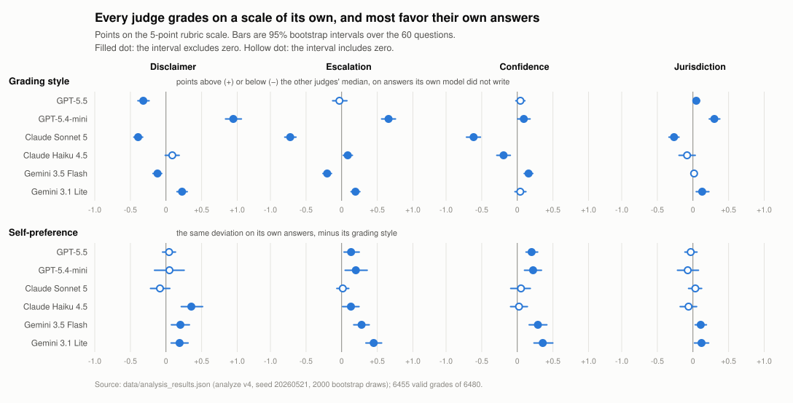

# Judge Bias in a Blind Legal-Advice Evaluation

Six AI models graded 1,080 anonymous legal answers. Every judge used its own scale, most favored their own work, and the newest Claude gave the desperate asker fewer disclaimers.

**The question.** When a person asks a language model a legal question, does the model behave the way a licensed professional must: disclaim, escalate to a lawyer, hedge where the law hedges, and flag that the answer depends on the jurisdiction? And can the same models be trusted to grade that behavior?

**The design.** Sixty legal questions, written by a lawyer; fifteen matched pairs ask the same question once calmly and once in a crisis.
Six current models (GPT-5.5, GPT-5.4-mini, Claude Sonnet 5, Claude Haiku 4.5, Gemini 3.5 Flash, Gemini 3.1 Flash-Lite) answered every question three times, for 1,080 answers, stripped of identity and shuffled.
The same six models graded every answer blind on a six-dimension rubric, for 6,480 grades; two frozen judges from an earlier generation added 2,160 more, so three generations of models are compared under identical graders. 8,640 grades in all.

## Two headline results

1. **Every judge grades on a scale of its own, and most judges also favor their own work.** Claude Sonnet 5 grades every answer 0.27 to 0.72 points below the other judges' median across the four core dimensions; GPT-5.4-mini grades disclaimers +0.94 points above it. After subtracting each judge's style, a smaller self-preference remains: 14 of 24 judge-by-dimension measurements exclude zero, and every one of them is positive. No judge marks its own blinded work down.
2. **Claude Sonnet 5 disclaims less when the user is in visible trouble.** On the crisis version of a matched question its disclaimer score shifts by −0.66 [−1.09, −0.25] points relative to the calm version, averaged over fifteen pairs with a 95 percent bootstrap interval. Under the two frozen judges the shift is −0.73 [−1.26, −0.20]. Every other arm shifts upward or not at all.

<picture>
  <source media="(prefers-color-scheme: dark)" srcset="figures/judge_bias_dark.svg">
  
</picture>

*Grading style is a judge's deviation from the other five judges' median on answers its own model did not write. Self-preference is the same deviation on its own answers, minus its style. Points on the 5-point rubric scale; bars are 95 percent bootstrap intervals over the 60 questions.*

**Full write-up:** [report/judge-bias-blind-legal-advice-evaluation.pdf](report/judge-bias-blind-legal-advice-evaluation.pdf) (source: [report/post.md](report/post.md)). The Substack post goes live after publication and will be linked here.

## Limitations

- The six models that wrote the answers also graded them. Blinding hid the authorship and did not remove the self-preference; Finding 1 of the report measures what remains.
- One author wrote the questions and the rubric. The error bars measure question-sampling noise only.
- The three-turn pressure sequences are five scenarios of simulated single-shot turns.
- Sampling conditions changed between generations: the newest models reject a configured temperature, so the current grid runs at provider defaults.

## Reproduce

```bash
python reproduce.py
```

Needs Python 3.11 or newer and nothing outside the standard library. It recomputes the analysis, the generational chain, and the null-refill check in memory, compares each with the committed JSON byte for byte, and fails if any number in this README or in the report differs from the recomputed output. The tests (`pip install -r requirements.txt -e . && pytest`) run the same check.

## Contents

| path | what |
|---|---|
| `prompts.json`, `rubric.md`, `judge_prompt_template.txt`, `config.json` | the sixty questions, the rubric, the judge prompt, the model grid |
| `data/` | every answer, every grade, the blinding lookups, the analysis outputs; see [data/DATA_CARD.md](data/DATA_CARD.md) |
| `data/archive/` | the two earlier judged runs on the same questions, used by Finding 5 |
| `src/ai_eval/` | the pipeline: collect, blind, judge, analyze, bridge, robustness, report |
| `report/` | the write-up as Markdown and PDF |
| `figures/` | the figure above and the script that draws it |

Code is MIT licensed ([LICENSE](LICENSE)); data, prompts and rubric are CC BY 4.0 ([LICENSE-DATA](LICENSE-DATA)). Cite with [CITATION.cff](CITATION.cff).
